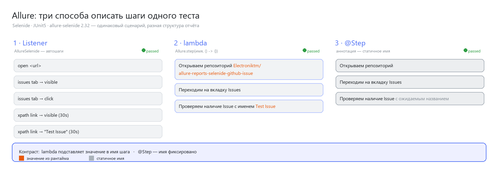

<div align="center">

# Allure Reports · Selenide

**Дополнительное занятие «Allure Reports»** — один сценарий автотестирования, реализованный тремя способами формирования отчёта Allure.


</div>

---

## О проекте

Сценарий *«проверка названия Issue в репозитории GitHub через Web‑интерфейс»* прогнан **одним и тем же** Page Object, но шаги отчёта Allure собираются тремя независимыми способами. В результате — три визуально разных отчёта по одному сценарию; это наглядно показывает отличия подходов.

| # | Способ | Как формируются шаги |
|---|--------|----------------------|
| 1 | **Listener** | Автоматически: `AllureSelenide` перехватывает каждый вызов Selenide |
| 2 | **Lambda steps** | Явно: `Allure.step("имя", () -> …)` — имя может содержать живые значения |
| 3 | **@Step** | Явно: аннотация `@Step` на методах (работает через `aspectjWeaver`) |

> Ключевое отличие: в lambda‑шагах в имя подставляются фактические значения (*«…репозиторий Electroniktm/…»*, *«…Issue с именем Test Issue»*), а имена `@Step` статичны.



> *Рис.* Дерево шагов каждого варианта в отчёте Allure — оранжевым выделены значения, подставленные в имя шага, серым — статичные имена.

## Структура проекта

```
src/test/java
├── pages/GithubPage.java        # Page Object: открыть репо → Issues → проверить название
├── steps/GithubSteps.java       # обёртка-шаги с @Step (вариант 3)
├── testdata/TestData.java       # константы цели: GITHUB_URL, REPOSITORY, ISSUE_NAME
└── tests/
    ├── TestBase.java            # AllureSelenide listener + конфигурация Selenoid
    └── GithubIssueTests.java    # 3 теста — по одному на каждый вариант
```

## Запуск

Требования: **JDK 17**, доступ в интернет (облачный Selenoid).

```bash
./gradlew test          # прогон тестов → build/allure-results
./gradlew allureReport  # отчёт   → build/reports/allure-report/allureReport/index.html
```

Откройте `build/reports/allure-report/allureReport/index.html` — там три теста с тремя разными деревьями шагов (у плагина `io.qameta.allure` 4.x отчёт кладётся в подкаталог с именем задачи).

## Целевой объект проверки

Тест проверяет наличие Issue с названием **`Test Issue`** на странице Issues публичного репозитория **`Electroniktm/allure-reports-selenide-github-issue`** (этот же). Браузер поднимается в облачном Selenoid (`selenoid.qa.guru`); версия Chrome не фиксируется.

## Технические решения

- **Поиск по тексту, а не по href.** GitHub рендерит `/issues` как client‑side React, и `href` якорей зависит от IP дата‑центра. Поэтому ссылка на Issue ищется ленивым XPath по тексту заголовка (`//a[contains(normalize-space(.),'Test Issue')]`) с таймаутом 30с — элемент переоткрывается каждый полл, что устойчиво к асинхронному рендеру и к `StaleElementReference`.
- **Selenide 7 API.** В Selenide 7 нет классов `Conditions`/метода `withText`; используются статические импорты `Condition.partialText` и `visible`.

---

<div align="center">

Собрано на **Gradle** · отчёт — **Allure** · автотесты — **Selenide + Selenium Grid (Selenoid)**

</div>
